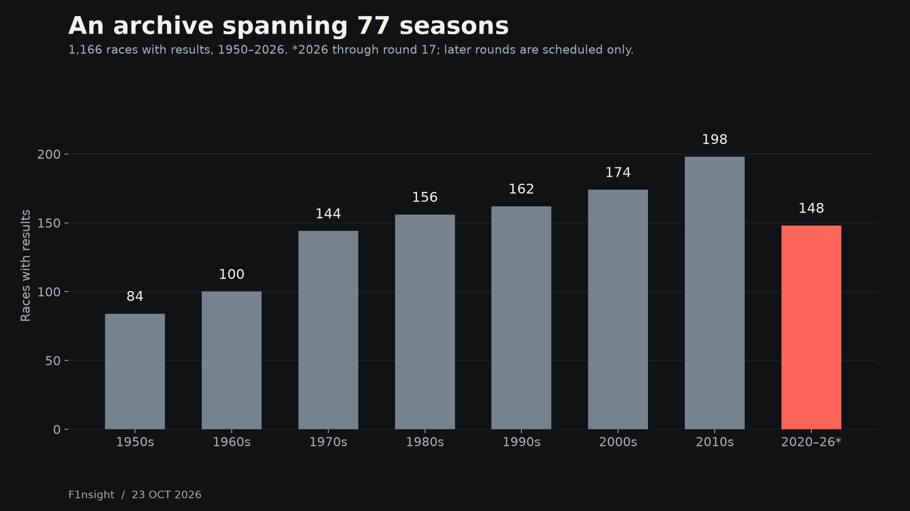
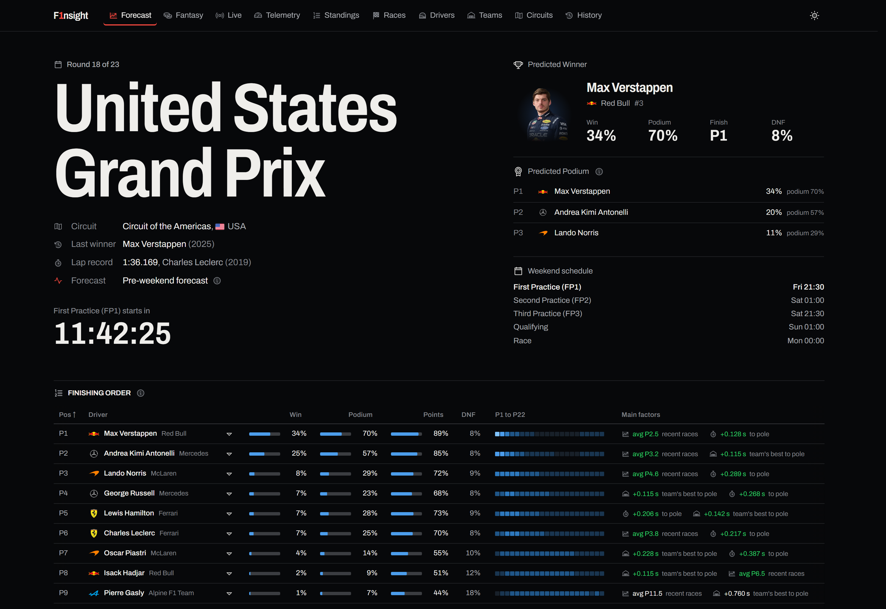
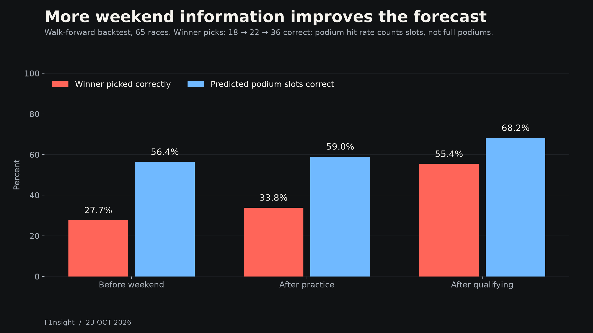
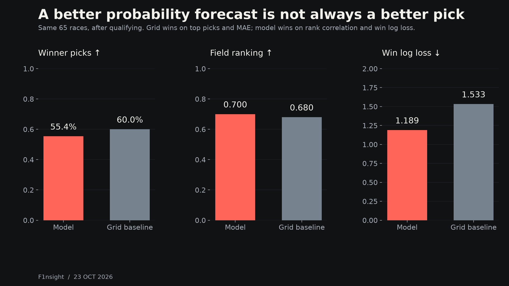
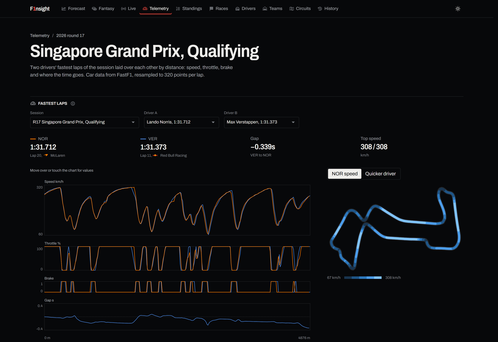

# Building F1nsight: 77 seasons of data, one connected pit wall

F1nsight started from a simple idea: put the race forecast, historical context, fantasy planning and lap-level analysis in one place. The interesting part is making all of those features agree about the same race, driver and session.

As of 23 October 2026, the serving database represents 77 seasons, from 1950 to 2026. It contains 1,166 races with results, 26,247 race-result rows, 881 driver records, 214 constructor records, 78 circuits, 635,331 lap-time rows and 12,881 pit stops. Another six race records are scheduled events without results, so they are excluded from the completed-race count.

Those numbers describe the dataset behind the product. They are not visitor or audience statistics, and coverage varies by data type and era.

## Several feeds, one shared model of Formula 1

The historical backbone comes from [Jolpica](https://api.jolpi.ca/docs/), with [F1DB](https://github.com/f1db/f1db) filling gaps and supplying additional session information. [FastF1](https://docs.fastf1.dev/) provides the detailed laps, sectors, tyres, positions and telemetry needed for session analysis. [OpenF1](https://openf1.org/docs/) adds historical session information, including stints, pits and overtakes. OpenF1's historical API is freely accessible; live data has separate access requirements.

FIA decisions and race-control messages provide announced penalties. Public F1 Fantasy feeds supply prices and points, with some scoring components reconstructed from the underlying racing data. These sources overlap, arrive at different times and use different identifiers. Normalizing them is as important as downloading them.

There is also an external signal that is easy to overlook: the live prediction path can blend the model with winner-market prices from [Polymarket](https://gamma-api.polymarket.com/docs). It uses a logarithmic pool, with a model exponent of 0.20 before the weekend and 0.35 after practice or qualifying. The remaining exponents belong to the market. This is not a simple arithmetic average, and the forecast falls back to the model when no usable market is available.

Market prices may indirectly reflect upgrades, rumours and paddock information. We do not currently parse general news articles into structured predictive features. [Open-Meteo](https://open-meteo.com/en/docs/historical-weather-api) observations and timestamped forecasts are collected for research, but weather is not yet an active production feature.

## Do the expensive work before someone opens the page

Python ingestion builds Parquet tables and a serving SQLite database. The modelling layer produces forecast and fantasy JSON. Next.js and React then prerender a static export, which Cloudflare Pages serves to readers. Live timing uses a separate FastAPI and WebSocket service.

GitHub Actions handles refreshes, retraining and publication. A Cloudflare cron Worker dispatches scheduled checks, with GitHub schedules as a fallback. The data persists as versioned release assets, divided into groups so refreshes and model training can update their own outputs.

The forecast combines XGBoost rankers, a set transformer, retirement modelling and Monte Carlo simulation. The default prediction run requests 20,000 simulations. That makes the distribution of possible outcomes explicit: win, podium, points and retirement probabilities come from simulated weekends rather than a single deterministic finishing order.

## What the backtest actually shows

The published walk-forward test covers 65 races: 24 from 2024, 24 from 2025 and the first 17 races of 2026. It trains on earlier races and retrains every three rounds. These are retrospective out-of-sample evaluations, not a record of 65 forecasts published live before each race.

Before the weekend, the model's favourite wins 18 of 65 races, or 27.7%. After practice that rises to 22 of 65, or 33.8%. After qualifying it reaches 36 of 65, or 55.4%. Predicted podium-slot hit rate rises from 56.4% to 68.2%. That podium metric counts individual slots, not perfectly predicted three-driver podiums.

The comparison with the starting grid is more interesting than a single accuracy number. After qualifying, the model's rank correlation with the finishing order is 0.700, compared with 0.680 for the grid baseline. Its winner log loss is 1.189 rather than 1.533, a 22.4% reduction.

But the grid baseline picks more winners: 39 of 65, compared with the model's 36. It also has slightly lower average position error, 3.22 rather than 3.25 places, and a slightly better win Brier score. The model does not win every comparison. Its advantage is in the field ranking and the probabilities assigned to the eventual winner, not in always naming a better favourite.

Season-level results also vary substantially. Overall averages are useful, but a partial season and a 65-race sample do not justify certainty about future performance. These figures evaluate the core published backtest; they do not independently validate the current live market blend.

## Making the numbers inspectable

The telemetry explorer contains 326 exported sessions and 6,437 driver-session fastest-lap entries. Each trace is resampled to 320 points, for 2,059,840 exported speed values. These are compact traces for comparing laps, not the complete raw sensor archive, and the same driver appears in many sessions.

A missing Singapore export recently exposed a useful failure mode. The results pipeline knew a session was complete, but a derived telemetry file was missing. Cloud runners did not retain the FastF1 cache, so repeating an offline export could not repair it. The fix restored all four Singapore sessions and added a 14-day online backfill for missing exports, even when the session's other data already exists.

It is a reminder that a successful workflow and a complete product are different measurements.

## Where to improve next

The next useful step is a frozen log of live forecasts, timestamped before each session and tied to exact input versions. That would separate untouched future results from development backtests.

For external information, the right comparison is model-only, market-only and pooled forecasts at identical lead times, with liquidity and missing-market cases reported. Weather should be tested using forecasts available before the race, not hindsight observations.

We also want race-level uncertainty intervals, calibration checks and better monitoring for missing or stale derived files. The current retraining gate checks whether a candidate stays within measured training-noise tolerances; that is useful protection, but it does not replace uncertainty about future seasons.

The goal is a site where the data's origin, the model's record and the limits of each feature remain visible alongside the predictions.

---

Snapshot: 23 October 2026. Published backtest generated 13 October 2026, through race 202617. Figures and screenshots are included in this folder; CSV values are in `tables/`. Implementation evidence is the [repository at commit 5a0aab8](https://github.com/karroge10/F1nsight/tree/5a0aab8). Source access terms and attribution requirements vary. F1nsight is a personal project and is not affiliated with Formula 1.
